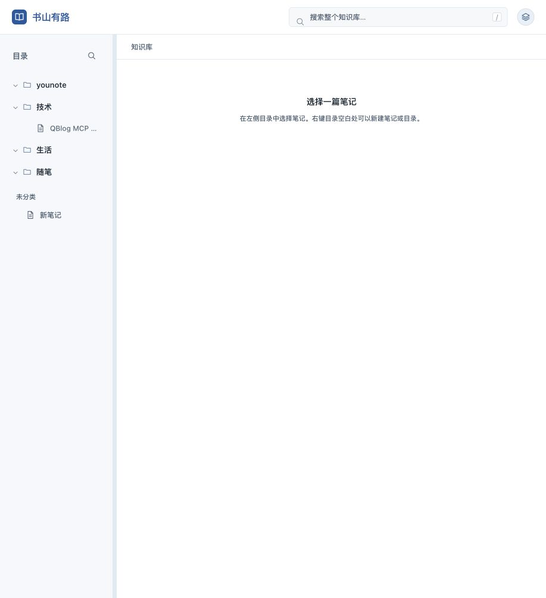
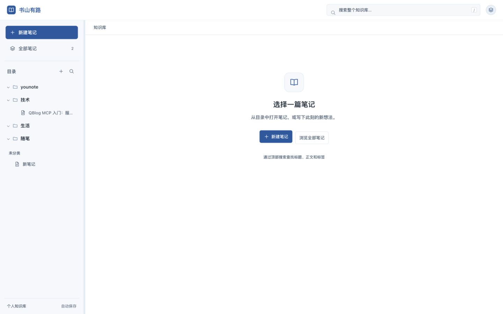
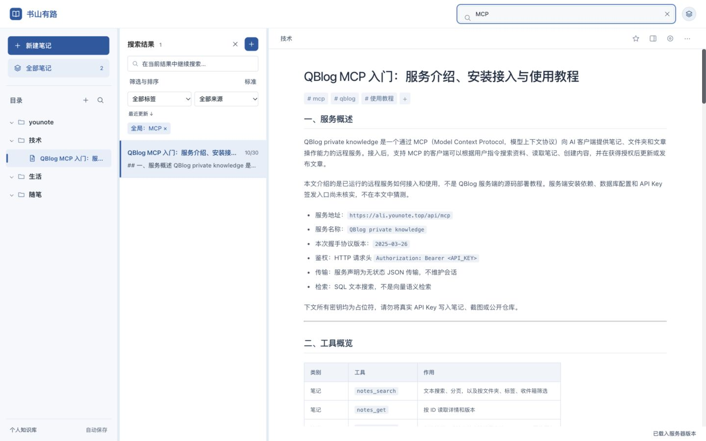
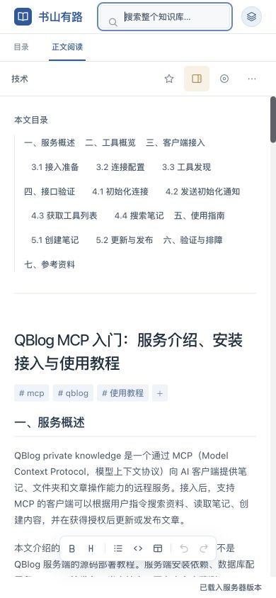

# 知识库 UI 检查与优化

检查时间：2026-10-30。范围：本地 `/blog/` 的知识库布局，覆盖进入首页、全文搜索、打开笔记、阅读和手机导航。基于本轮实际页面截图与交互，沿用现有蓝灰配色和目录／正文结构。

## 检查步骤与结果

| 步骤 | 原有体验与问题 | 已完成的优化 | 结果 |
| --- | --- | --- | --- |
| 1. 进入知识库 | 首页仅提示选择笔记，新建依赖右键；空白区域缺少明确操作。 | 目录栏增加新建笔记、全部笔记、新建目录入口；首页增加新建和浏览按钮。 | 已改善，保留简洁的双栏阅读布局。 |
| 2. 查找笔记 | 桌面列表被 CSS 隐藏，输入关键词后看不到结果列表；知识库请求遗漏列表搜索、标签和来源条件。 | 搜索时显示结果、数量、可移除条件；补齐请求参数；增加搜索清除和关闭列表入口。 | 已修复，支持无结果提示和返回目录。 |
| 3. 打开与阅读笔记 | 较窄窗口的文章目录默认占据正文上方；格式工具栏在阅读时悬浮并遮挡内容。 | 文章目录默认收起，按需打开为可滚动浮层；正文获得优先空间；编辑工具栏仅在编辑器或其工具按钮获得焦点时显示。 | 已改善，手机首屏直接展示文章标题与正文。 |
| 4. 手机导航及目录操作 | 手机导航缺少笔记列表入口，右键管理难以发现；目录栏较窄，长标题难以辨认。 | 增加目录／笔记／正文三项导航；目录操作提供可点击菜单；扩大触控按钮和行高；桌面目录默认宽度调至 240px，长标题提供完整提示。 | 已改善，390、768、1024、1440px 未发现页面横向溢出。 |

## 交互与可访问性

- 当前笔记和手机导航增加 `aria-current`；搜索结果数量通过状态区域通报。
- 格式按钮补充中文可访问名称；保留可见焦点样式。
- 目录操作菜单支持键盘聚焦、方向键和 Escape，关闭后回到触发按钮。
- 文章目录可用 Escape 收起；列表可在窄桌面窗口关闭并回到目录。
- 列表标签、来源及列表内搜索在接口中与全文搜索叠加；新搜索结果不会被较早的慢请求覆盖。
- 搜索结果按本地页码展示，目录树仍可使用已加载的全部匹配记录。

## 截图

以下均为本轮捕获并检查过的页面截图。前后桌面截图窗口宽度不同，用于验证功能与层级变化，不作为逐像素对比。

### 1. 首页

优化前：

优化后：

### 2. 桌面全文搜索

优化前，输入关键词后没有结果列表：

优化后，显示结果、筛选条件和正文：

### 3. 手机阅读

优化前，目录占据首屏，格式栏遮挡内容：

优化后，优先显示文章内容：

### 4. 手机笔记列表

优化后提供明确的笔记导航、结果数量和可移除筛选：

## 验证与边界

- `npm test`：72 项全部通过。新增覆盖组合搜索参数、跨页结果、请求竞争与失败时保留结果的回归测试。
- `npm run lint`：通过，无错误或警告。
- `npm run build`：通过。构建工具仍提示部分依赖包超过 500kB，此轮未调整依赖拆包。
- 在应用内浏览器实测首页、搜索命中、无结果、清除搜索、关闭列表、目录操作菜单、Escape 退出、文章目录展开／收起，以及格式工具栏随编辑焦点显示／隐藏。
- 视口检查：390×844、768×1024、1024×768、1440×900。检查后恢复浏览器默认尺寸。
- 此轮视觉检查针对浅色知识库布局；未完整审计登录、设置、其他布局和深色模式，未进行屏幕阅读器完整验证，因此不宣称整体符合 WCAG。
- 未通过页面创建、修改或删除真实笔记；保存与冲突保护依靠现有自动化测试验证。工作区原有未提交修改保留。
